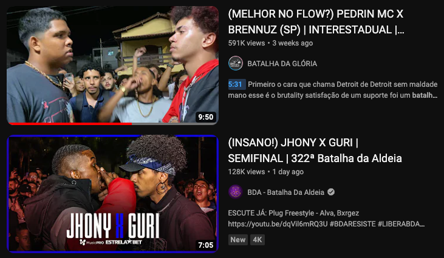
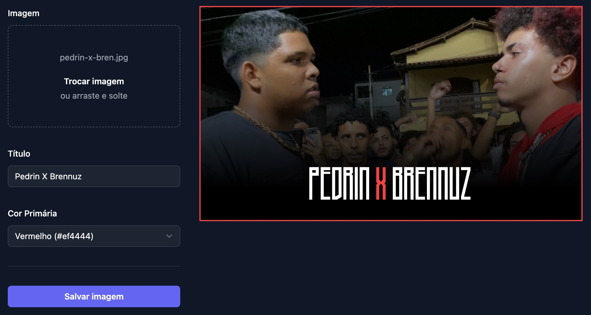

# Miniatura de Vídeo para Batalhas de Rima

Todas as semanas centenas de batalhas de rima acontecem no Brasil e uma parte
consideravel destas batalhas são postadas no YouTube. Como membro da organização
de uma batalha ([@batalhadamalta](https://instagram.com/batalhadamalta/)), sei
que é trabalhoso gerar boas miniaturas/thumbnails para aumentar o alcance das
publicações. Subimos em média 15 vídeos por semana, isto é, em média 15 edições
de imagem para contemplar todas as miniaturas.

A motivação desta aplicação é tornar a criação de miniaturas de vídeo mais
acessíveis para organizações de batalhas, pois nem todas possuem tempo ou
recursos para elaborar um bom design. Além disso, a aplicação também ajuda a
agilizar o processo para organizações que já publicam os vídeos com suas própias
miniaturas.

Por exemplo, com uma breve busca no YouTube é possível notar o contraste de
miniaturas entre uma batalha de menor visibilidade ([Batalha da
Glória](https://www.youtube.com/@batalhadagloria/)) e uma batalha profissional
([Batalha da Aldeia](https://www.youtube.com/@batalhadaaldeia)).



Após carregar a miniatura original do vídeo da Batalha da Glória na aplicação,
um resultado melhor é obtido com pouco esforço.



Ao salvar a imagem, um arquivo PNG de resolução 1280 × 720 (16:9) é exportado
para o computador. [Esta já é a resolução ideal para o
YouTube](https://support.google.com/youtube/answer/72431?hl=en#zippy=%2Cimage-size-resolution).

## Funcionalidades

- Recorte da imagem no formato 16:9
- Título com destaque automático de "X" e "VS", destaque manual com asteriscos
  (`Grande *Final*`) e modo itálico com aspas duplas (`"Quem é o maior campeão?"`)
- 7 fontes diferentes
- Cores pré-definidas e cor customizada
- Estilos de borda e texturas granuladas
- Logo da batalha sobreposto à miniatura
- Fonte, cor, borda, textura e logo ficam salvos no navegador entre as visitas

Dependendo do interesse da comunidade, posso evoluir as funcionalidades. Confira
a página de colaboração da aplicação para saber como entrar em contato.

## Como executar a aplicação localmente

Se você for um programador, siga esses passos para executar a aplicação
localmente.

Primeiro, instale as dependências:

```bash
yarn install
```

Depois, inicie o servidor de desenvolvimento local:

```bash
yarn dev
```

Abra [http://localhost:3000](http://localhost:3000) em seu navegador para ver a
aplicação e edite o código em `src/app/editor/page.tsx` para ver as alterações
em tempo-real.

Os testes end-to-end usam [Cypress](https://www.cypress.io/). Com o servidor de
desenvolvimento rodando, execute:

```bash
yarn cypress open
```
